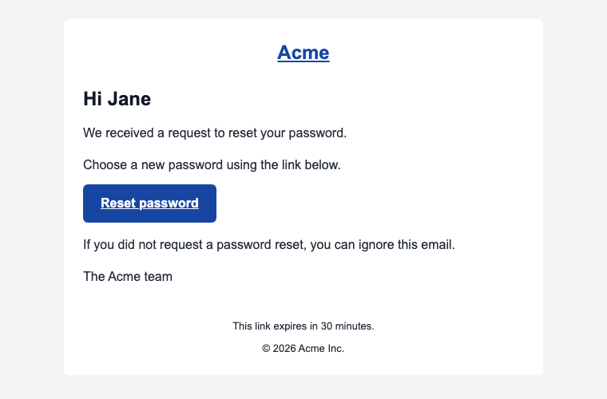

# PatraMail

PatraMail generates responsive HTML and plain text for transactional emails from
one JavaScript object. It runs on Node.js 18+ using CommonJS and zero runtime
dependencies. Pass the output to your existing email transport.

```sh
npm install patramail
```

## Quick start

```js
const PatraMail = require('patramail');

const mailGenerator = new PatraMail({
  theme: 'default',
  product: {
    name: 'Acme',
    link: 'https://acme.test',
  },
});

const email = {
  body: {
    name: 'Jane',
    intro: 'Welcome to Acme! Your account is ready.',
    action: {
      instructions: 'Confirm your email address to get started.',
      button: {
        color: '#1746a2',
        text: 'Confirm your account',
        link: 'https://acme.test/confirm?token=example',
      },
    },
    outro: 'If you have questions, reply to this email.',
  },
};

const emailBody = mailGenerator.generate(email);
const emailText = mailGenerator.generatePlaintext(email);

require('node:fs').writeFileSync('preview.html', emailBody, 'utf8');
```

Open `preview.html` in a browser, or pass `emailBody` and `emailText` to your
email transport.



## Account and event templates

Use `templates.passwordReset`, `templates.emailVerification`, or
`templates.dashboardWelcome` for common account emails. Each accepts the
action URL from your application and generates matching HTML and text.
See the [account template example](docs/api.md#account-templates).

Choose from invitation, registration confirmation, reminder, event update,
cancellation, and follow-up templates. Each supplies event copy, a color
palette, and an optional action button. See the
[event template guide](docs/events.md) for a complete example.

Use `const { PatraMail } = require('patramail')` when you want the
combined `{ html, text, subject, preheader }` result in one call.
See the [API reference](docs/api.md).

## Send with Nodemailer

Install Nodemailer in your application with `npm install nodemailer`. Copy the
quick start into an async function, then use the generated HTML and text with your SMTP settings.

```js
const nodemailer = require('nodemailer');
const transport = nodemailer.createTransport(process.env.SMTP_URL);
await transport.sendMail({
  from: process.env.MAIL_FROM,
  to: process.env.MAIL_TO,
  subject: 'Confirm your Acme account',
  html: emailBody,
  text: emailText,
});
```

Set `SMTP_URL` to your provider's SMTP URL and set `MAIL_FROM` and `MAIL_TO`
to your sender and recipient addresses.

## Examples and reference

- [Mailgen-style quick start](examples/mailgen-style/index.js) writes a local HTML preview and prints the plain-text version.
- [Password reset](examples/password-reset.js) and [receipt](examples/receipt.js) print HTML when run with Node.
- [Nodemailer example](examples/with-nodemailer.js) emits a complete MIME message to stdout with Nodemailer installed. Set `SMTP_URL`, `MAIL_FROM`, and `MAIL_TO` to send it using your SMTP provider.
- `npm run preview` in this repository generates the example HTML files under `preview/`.
- [API reference](docs/api.md), [input schema](docs/input-schema.md), and [themes](docs/themes.md).

## Email-client compatibility

Chrome previews verified desktop light and dark layouts and a 375px receipt
with a horizontally scrolling table. The browser preview is useful for layout
checks. Inbox verification is still pending for Gmail, Outlook desktop and web,
Apple Mail, and a mobile email client.

- Classic Outlook may display square corners and use the inline fallback colors.
  Dark-mode recoloring varies by client. [Can I email dark mode results](https://www.caniemail.com/features/css-at-media-prefers-color-scheme/)
- Some clients may ignore the receipt's scrolling wrapper or clip a wide table.
  Keep transactional tables narrow when targeting those clients. [Can I email overflow results](https://www.caniemail.com/features/css-overflow/)

For a transport smoke test, [Ethereal](https://ethereal.email/) catches messages
in a free SMTP sandbox. For an inbox check, send to accounts you control or use
a service that renders the supported clients.

## Development

Run `npm ci`, `npm test`, and `npm run lint`. When changing the generated
markup intentionally, run `UPDATE_SNAPSHOTS=1 npm test` and review the
resulting diffs in `test/snapshots/`.
