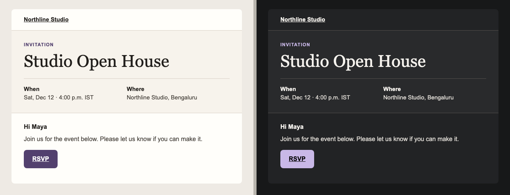

<div align="center">

# PatraMail

**Transactional emails from a JavaScript object.**

Responsive HTML and matching plain text for account emails, events, receipts, and your own messages.

[](https://nodejs.org/)
[](package.json)
[](LICENSE)

[GitHub repository](https://github.com/sarthak-gupta229/patramail) · [Quick start](#quick-start) · [Templates](#templates) · [Custom emails](#build-a-custom-email) · [API reference](https://github.com/sarthak-gupta229/patramail/blob/main/docs/api.md)

</div>



## Quick start

```sh
npm install patramail
```

Generate a password-reset email from an action URL supplied by your app.

```js
const PatraMail = require('patramail');
const mailer = new PatraMail({
  product: { name: 'Acme', link: 'https://acme.test' },
});

const email = PatraMail.templates.passwordReset({
  recipient: 'Jane',
  link: 'https://acme.test/reset?token=example',
});

const html = mailer.generate(email);
const text = mailer.generatePlaintext(email);

require('node:fs').writeFileSync('preview.html', html, 'utf8');
```

Open `preview.html` in a browser. PatraMail generates the content. Your email
transport handles delivery. For both formats and the subject and preheader in
one call, use the [named `PatraMail` constructor](https://github.com/sarthak-gupta229/patramail/blob/main/docs/api.md).

## Templates

<details>
<summary>Preview a password-reset email</summary>


</details>

| Account templates                          | Event templates                              |
| ------------------------------------------ | -------------------------------------------- |
| `passwordReset` · Reset password           | `invitation` · Collect RSVPs                 |
| `emailVerification` · Verify email address | `confirmation` · Confirm a registration      |
| `dashboardWelcome` · Go to dashboard       | `reminder` · Send details before the event   |
|                                            | `update` · Announce a change                 |
|                                            | `cancellation` · Notify attendees            |
|                                            | `followUp` · Share resources after the event |

Account templates take an action URL from your app. Event templates can include
a date, location, and action button. All nine generate HTML and plain text.
[Account template options](https://github.com/sarthak-gupta229/patramail/blob/main/docs/api.md#account-templates) · [Event template options](https://github.com/sarthak-gupta229/patramail/blob/main/docs/events.md)

## Build a custom email

Pass your own `body` to create a message from scratch. The default constructor
supports the Mailgen-style `body.action`, `generate()`, and
`generatePlaintext()` workflow. Choose the built-in light or dark theme,
or pass custom colors and typography.

```js
const PatraMail = require('patramail');
const mailer = new PatraMail({
  product: { name: 'Acme', link: 'https://acme.test' },
  theme: { brand: '#30564b', radius: '8px' },
});

const email = {
  body: {
    title: 'Your statement is ready',
    intro: [
      'Your monthly statement is available.',
      'View or download it in your account.',
    ],
    action: [
      {
        button: {
          text: 'View statement',
          link: 'https://acme.test/billing/statement',
        },
      },
      { button: { text: 'Manage billing', link: 'https://acme.test/billing' } },
    ],
    outro: 'Reply to this email if you have questions.',
  },
  footer: {
    links: [{ text: 'Contact support', link: 'mailto:help@acme.test' }],
  },
};

const html = mailer.generate(email);
const text = mailer.generatePlaintext(email);
```

Add a preheader, product logo, or receipt table using the [input schema](https://github.com/sarthak-gupta229/patramail/blob/main/docs/input-schema.md).
PatraMail escapes user content by default and validates action URLs.
[Theme options](https://github.com/sarthak-gupta229/patramail/blob/main/docs/themes.md) · [Mailgen-style API](https://github.com/sarthak-gupta229/patramail/blob/main/docs/api.md#mailgen-style-usage)

## Send with Nodemailer

Install Nodemailer with `npm install nodemailer`. Pass the generated content
to your transport inside an async function.

```js
const nodemailer = require('nodemailer');

const transport = nodemailer.createTransport(process.env.SMTP_URL);
await transport.sendMail({
  from: process.env.MAIL_FROM,
  to: process.env.MAIL_TO,
  subject: 'Reset your Acme password',
  html,
  text,
});
```

Set `SMTP_URL`, `MAIL_FROM`, and `MAIL_TO` for your provider.
The [runnable Nodemailer example](https://github.com/sarthak-gupta229/patramail/blob/main/examples/with-nodemailer.js) can also print
a complete MIME message locally.

## Preview and develop

```sh
npm ci
npm run preview
npm test
npm run lint
```

Open the generated files in `preview/`. The repository also includes runnable
[account](https://github.com/sarthak-gupta229/patramail/blob/main/examples/account.js), [event](https://github.com/sarthak-gupta229/patramail/blob/main/examples/events.js),
[receipt](https://github.com/sarthak-gupta229/patramail/blob/main/examples/receipt.js), and [Mailgen-style](https://github.com/sarthak-gupta229/patramail/blob/main/examples/mailgen-style/index.js)
examples. To update HTML snapshots intentionally, run
`UPDATE_SNAPSHOTS=1 npm test` and review the diffs.

<details>
<summary>Email-client compatibility</summary>

Chrome previews verified desktop light and dark layouts and the 375px receipt
layout. Real inbox verification is pending for Gmail, Outlook, Apple Mail,
and mobile email clients.

Classic Outlook may show square corners. Dark-mode recoloring and wide-table
scrolling vary by client. [Dark-mode support](https://www.caniemail.com/features/css-at-media-prefers-color-scheme/) · [Overflow support](https://www.caniemail.com/features/css-overflow/)

</details>

[Changelog](https://github.com/sarthak-gupta229/patramail/blob/main/CHANGELOG.md) · [MIT License](https://github.com/sarthak-gupta229/patramail/blob/main/LICENSE)
